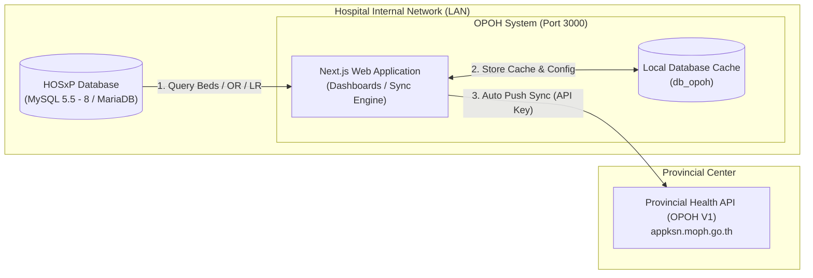

<div align="center">
  
  
  
  
  
  
  <br />
  <br />

  <h1>Kalasin OPOH Sync Platform</h1>
  <p>
    <b>ระบบบริหารจัดการและเชื่อมโยงข้อมูลสารสนเทศทางการแพทย์ One Province One Hospital (OPOH)</b><br />
    รองรับการดึงข้อมูลเตียง (Beds), ห้องคลอด (LR), ห้องผ่าตัด (OR) และคิวผ่าตัด (Surgical Queue)<br />
    จากระบบ HIS (HOSxP) ของโรงพยาบาล พร้อมระบบแคชข้อมูลและส่งเข้าสู่ระบบศูนย์กลาง สสจ. อัตโนมัติ
  </p>
</div>

<br />

---

## 📑 สารบัญ (Table of Contents)
1. [คุณสมบัติเด่นของระบบ (Key Features)](#-คุณสมบัติเด่นของระบบ-key-features)
2. [สถาปัตยกรรมการทำงาน (System Architecture)](#-สถาปัตยกรรมการทำงาน-system-architecture)
3. [สิ่งที่ต้องเตรียมก่อนติดตั้ง (Prerequisites)](#-สิ่งที่ต้องเตรียมก่อนติดตั้ง-prerequisites)
4. [วิธีติดตั้งแบบที่ 1: Docker Deployment (แนะนำ)](#-วิธีติดตั้งแบบที่-1-docker-deployment-แนะนำและได้มาตรฐานสูงสุด)
5. [วิธีติดตั้งแบบที่ 2: Node.js / PM2 (Bare-Metal / Server ติดตั้งตรง)](#-วิธีติดตั้งแบบที่-2-nodejs--pm2-bare-metal-manual-install)
6. [การตั้งค่าฐานข้อมูลผ่านหน้าเว็บ (UI Database Configuration)](#-การตั้งค่าฐานข้อมูลผ่านหน้าเว็บ-ui-database-configuration)
7. [การยืนยันตัวตนและการจัดการสิทธิ Admin (Authentication & MFA)](#-การยืนยันตัวตนและการจัดการสิทธิ-admin-authentication--mfa)
8. [การนำไปใช้ร่วมกันหลายโรงพยาบาล (Multi-Hospital Setup Checklist)](#-การนำไปใช้ร่วมกันหลายโรงพยาบาล-multi-hospital-setup-checklist)
9. [การแก้ไขปัญหาที่พบบ่อย (Troubleshooting & FAQ)](#-การแก้ไขปัญหาที่พบบ่อย-troubleshooting--faq)

---

## 🚀 คุณสมบัติเด่นของระบบ (Key Features)
- **Universal Multi-Hospital Support:** ออกแบบโครงสร้างให้สามารถนำไปติดตั้งได้กับโรงพยาบาลชุมชนและโรงพยาบาลทั่วไปทุกแห่งในจังหวัด โดยไม่ต้องแก้ไข Source Code
- **Dual Deployment Ready:** รองรับการติดตั้งทั้งแบบ **Docker Container (Isolated & One-Click)** และแบบ **Node.js 20+ (PM2 / Standalone Service)**
- **Smart HOSxP Integration:** รองรับการอ่านและตรวจสอบรหัสผ่าน HOSxP V3 / V4 XE (MD5, Passweb, SHA256) และระบบตรวจจับสิทธิ์ Admin อัตโนมัติจากตาราง `opduser`
- **Auto Sync & Circuit Breaker:** ระบบตั้งเวลาซิงก์ข้อมูลอัตโนมัติ (Background Scheduler) พร้อมกลไกป้องกัน Rate Limit (HTTP 429) และ Safe Timer Cleanup
- **High Security:** ระบบยืนยันตัวตน 2 ขั้นตอน (MFA: Google Authenticator / TOTP) พร้อมรหัสกู้คืนฉุกเฉิน และคำสั่ง CLI สำหรับรีเซ็ต MFA ของ Admin
- **In-Memory Hot-Reload:** แก้ไขการเชื่อมต่อฐานข้อมูลจากหน้าเว็บได้ทันที โดยไม่ต้อง Restart Container หรือ Server

---

## 🏗️ สถาปัตยกรรมการทำงาน (System Architecture)



---

## 📋 สิ่งที่ต้องเตรียมก่อนติดตั้ง (Prerequisites)

| ซอฟต์แวร์ / สภาพแวดล้อม | เวอร์ชันที่ต้องการ | หมายเหตุ |
| :--- | :--- | :--- |
| **Git** | 2.30+ | ใช้โคลนโปรเจกต์ |
| **Docker & Docker Compose** | Docker 24+ / Compose v2+ | สำหรับการติดตั้งแบบ Docker (วิธีที่ 1) |
| **Node.js** | **>= 20.0.0 LTS** | สำหรับการติดตั้งแบบ Node.js ตรง (วิธีที่ 2) |
| **MySQL / MariaDB** | MySQL 5.7, 8.0 หรือ MariaDB 10.4+ | สำหรับฐานข้อมูล Local Cache (db_opoh) |
| **HIS Connection** | สิทธิ์เข้าถึงฐานข้อมูล HOSxP | IP, Port, Username, Password, Database Name |

---

## 🐳 วิธีติดตั้งแบบที่ 1: Docker Deployment (แนะนำและได้มาตรฐานสูงสุด)

การรันด้วย Docker Compose เป็นวิธีที่สะดวก รวดเร็ว และเป็นสัดส่วนที่สุด โดยตัว Compose จะสร้าง Web Application (Port 3000) และ MariaDB (Port 3307) ให้พร้อมใช้งานทันที

### ขั้นตอนการติดตั้ง:
```bash
# 1. โคลน Repository
git clone https://github.com/witsanu-dev/kalasin-opoh.git
cd kalasin-opoh

# 2. คัดลอกไฟล์คอนฟิกตัวอย่าง
cp .env.example .env
```

### ปรับแต่งค่าใน `.env`:
เปิดไฟล์ `.env` ด้วย Text Editor และตั้งค่าข้อมูลของโรงพยาบาล:
```ini
# 1. ข้อมูลโรงพยาบาล
APP_PORT=3000
NEXT_PUBLIC_HOSPITAL_CODE=11078
NEXT_PUBLIC_HOSPITAL_NAME=KAMALASAI
NEXT_PUBLIC_HOSPITAL_FULL_NAME=โรงพยาบาลกมลาไสย

# 2. คอนฟิกเชื่อมต่อศูนย์กลาง
OPOH_BASE_URL=https://appksn.moph.go.th/opoh/api/v1
API_KEY=รหัส_API_Key_ที่ได้รับจาก_สสจ
# ช่องทางเข้าดู API Token: https://appksn.moph.go.th/opoh/

# 3. การเชื่อมต่อ HOSxP ของโรงพยาบาล
# หาก HOSxP อยู่บนเครื่อง Host เดียวกัน ให้ใช้: host.docker.internal
# หาก HOSxP อยู่บนเครื่องอื่นในวง LAN ให้ใส่ IP LAN เช่น 192.168.1.100
HOSXP_DB_HOST=192.168.1.100
HOSXP_DB_PORT=3306
HOSXP_DB_USER=sa
HOSXP_DB_PASSWORD=your_hosxp_password
HOSXP_DB_NAME=hos

# 4. รหัสผ่าน JWT และ Cookie (ตั้งเป็น false หากเปิดเว็บผ่าน HTTP ธรรมดาในวง LAN)
COOKIE_SECURE=false
JWT_SECRET=your_super_secret_jwt_random_key_min_32_chars
```
> 🔗 **ช่องทางการเข้าดู API Token สำหรับส่งข้อมูล:** [https://appksn.moph.go.th/opoh/](https://appksn.moph.go.th/opoh/)

### สั่งสร้างและสตาร์ท Container:
```bash
docker compose up -d --build
```

### ตรวจสอบสถานะการทำงาน:
```bash
docker compose ps
docker compose logs -f opoh-web
```
- **เปิดใช้งานหน้าเว็บ:** เข้าผ่านเว็บบราวเซอร์ที่ `http://localhost:3000` (หรือ `http://<IP-Server>:3000`)
- **จัดการฐานข้อมูล Local Cache:** สามารถใช้โปรแกรม Navicat / DBeaver / HeidiSQL ต่อเข้าไปที่ Port **`3307`** (User: `root` หรือ `opoh`, Password: `opoH@2026`, Database: `db_opoh`) โดยไม่ชนกับ MySQL พอร์ต 3306 ของเครื่องแม่

---

## 🖥️ วิธีติดตั้งแบบที่ 2: Node.js / PM2 (Bare-Metal Manual Install)

สำหรับเซิร์ฟเวอร์ที่ไม่ต้องการติดตั้ง Docker หรือต้องการรันโปรเจกต์บน Windows Server / Linux ร่วมกับ Node.js โดยตรง

### 1. ติดตั้ง Dependencies
```bash
git clone https://github.com/witsanu-dev/kalasin-opoh.git
cd kalasin-opoh

npm install
```

### 2. นำเข้าฐานข้อมูล Local Cache
สร้างฐานข้อมูล `db_opoh` บน MySQL/MariaDB ในเครื่องของคุณ จากนั้นนำเข้าไฟล์ SQL:
```bash
# นำเข้าโครงสร้างตารางและผู้ใช้งานเริ่มต้น
mysql -u root -p < database/db_opoh.sql
```
*(ในไฟล์ `db_opoh.sql` มีคำสั่ง `CREATE DATABASE IF NOT EXISTS db_opoh` และเลือกตารางให้อัตโนมัติแล้ว)*

### 3. ตั้งค่า `.env`
```bash
cp .env.example .env
```
ตรวจสอบให้แน่ใจว่า:
- `LOCAL_DB_HOST=127.0.0.1` (ชี้ไปที่ MySQL ในเครื่อง)
- `HOSXP_DB_HOST` ชี้ไปที่ IP ของ HOSxP
- กำหนด `APP_PORT=3000`

### 4. คอมไพล์โปรเจกต์ (Production Build)
```bash
npm run build
```

### 5. สตาร์ทระบบด้วย PM2 (แนะนำสำหรับ Production)
> [!IMPORTANT]
> **สำคัญ:** ให้รัน PM2 ในรูปแบบ **Fork Mode (1 Instance)** เสมอ เพื่อป้องกันไม่ให้ Background Auto-Sync รันซ้ำซ้อน
```bash
# ติดตั้ง PM2 (หากยังไม่มี)
npm install -g pm2

# สตาร์ทระบบ
pm2 start npm --name "kls_opoh" -- start

# บันทึกสถานะเพื่อให้เปิดโปรแกรมอัตโนมัติเมื่อรีสตาร์ทเครื่อง
pm2 save
pm2 startup
```

---

## 🔌 การตั้งค่าฐานข้อมูลผ่านหน้าเว็บ (UI Database Configuration)

ระบบมาพร้อมกับหน้าต่าง **"Database Configuration Modal"** เพื่ออำนวยความสะดวกให้ผู้ดูแลระบบสามารถปรับเปลี่ยน IP ฐานข้อมูลและทดสอบการเชื่อมต่อได้โดยตรง:

1. เปิดไปที่หน้า Login: `http://localhost:3000/login`
2. คลิกที่ **ไอคอนรูปฐานข้อมูล (Database Icon)** บริเวณมุมล่างของหน้าจอ
3. กรอกข้อมูล Host, Port, User, Password ของ HOSxP และ Local Database:
   - **ฐานข้อมูลระบบ (Local DB):** รองรับทั้ง Container ภายใน (`opoh-db:3306`), **AppServ**, **XAMPP** หรือ MySQL/MariaDB ในเครื่องแม่ข่าย (สามารถระบุ `127.0.0.1` หรือ `localhost` และ Port เช่น `3306` หรือพอร์ตอื่นๆ ได้ทันที ระบบ Docker มี Smart Gateway Map เข้าเครื่อง Host ให้อัตโนมัติ พร้อมปุ่มเลือก Preset 1-Click)
4. กดปุ่ม **"ทดสอบการเชื่อมต่อ" (Ping & Deep Check):**
   - ระบบจะทดสอบทั้ง Network Ping และตรวจสอบความพร้อมของตารางหลัก (`opduser`, `officer`, `doctor`, `ward`)
5. กดปุ่ม **"บันทึกการตั้งค่า":**
   - ระบบจะทำการ **Hot-Reload In-Memory Connection Pool** ทันที และบันทึกลงฐานข้อมูล `system_config` รวมถึงไฟล์ `.env`
   - **ผู้ใช้งานสามารถเข้าสู่ระบบและเริ่มใช้งานได้ทันทีโดยไม่ต้อง Restart Server หรือ Container**

---

## 🔐 การยืนยันตัวตนและการจัดการสิทธิ Admin (Authentication & MFA)

### 1. การตรวจสอบสิทธิ์ Admin แบบอัตโนมัติ (Universal Admin Detection)
ระบบจะตรวจจับผู้ใช้งาน HOSxP ที่มีสิทธิ์ระดับ Admin ให้อัตโนมัติ โดยอ้างอิงจากตาราง `opduser`:
- อยู่ในกลุ่ม `groupname` ที่มีคำว่า `admin`, `administrator`, `ศูนย์คอมพิวเตอร์`, `งานสารสนเทศ`
- มีสิทธิ์ใน `accessright` ที่มีคำว่า `[ADMIN]`
- มีตำแหน่งงาน `position` ที่มีคำว่า `นักวิชาการคอมพิวเตอร์`, `เจ้าพนักงานคอมพิวเตอร์`
- หรือระบุ Username ไว้ในตัวแปร `ADMIN_USERNAMES=admin,sa,ict,it,...` ในไฟล์ `.env`

### 2. บัญชีผู้ดูแลระบบฉุกเฉินเริ่มต้น (Default Local Admin)
หากยังไม่ได้เชื่อมต่อ HOSxP สามารถเข้าสู่ระบบด้วยบัญชี Local Admin:
- **Username:** `admin`
- **Password:** `opoH@2026`

### 3. ระบบยืนยันตัวตน 2 ขั้นตอน (2-Factor Authentication / TOTP)
- รองรับ Google Authenticator, Microsoft Authenticator และแอป TOTP มาตรฐาน
- ผู้ใช้งานจะได้รับ **รหัสกู้คืนฉุกเฉิน (Recovery Codes)** 10 ชุดเมื่อเปิดใช้งาน MFA

### 4. คำสั่ง CLI รีเซ็ต MFA กรณีทำรหัสหาย (Emergency MFA Reset)
หากผู้ใช้งานทำอุปกรณ์หาย หรือลบแอปยืนยันตัวตน ผู้ดูแลระบบสามารถใช้คำสั่ง CLI ผ่าน Terminal เพื่อปลดล็อกได้ทันที:
```bash
# รูปแบบ: npm run reset-mfa <username>
npm run reset-mfa admin
```
*(หากรันบน Docker สามารถใช้คำสั่ง: `docker exec -it opoh_web node scripts/reset-mfa.js <username>`)*

---

## 🏥 การนำไปใช้ร่วมกันหลายโรงพยาบาล (Multi-Hospital Setup Checklist)

เมื่อนำโปรเจกต์นี้ไปติดตั้งให้โรงพยาบาลอื่นๆ ให้ปฏิบัติตาม Checklist ดังนี้:

- [ ] **1. อัปเดตรหัสและชื่อโรงพยาบาลใน `.env`:**
  - `NEXT_PUBLIC_HOSPITAL_CODE` (เช่น `11077`)
  - `NEXT_PUBLIC_HOSPITAL_NAME` (เช่น `NAMON`)
  - `NEXT_PUBLIC_HOSPITAL_FULL_NAME` (เช่น `โรงพยาบาลนามน`)
- [ ] **2. สั่ง Build ใหม่เสมอ:**
  - แบบ Docker: `docker compose up -d --build`
  - แบบ Node.js: `npm run build && pm2 restart kls_opoh`
- [ ] **3. ตั้งค่า API Key:**
  - ขอ API Key สำหรับส่งข้อมูล OPOH จากกลุ่มงานสารสนเทศ สสจ. แล้วนำมากรอกใน `.env` หรือผ่านหน้าต่างตั้งค่าระบบ
- [ ] **4. ตรวจสอบการเชื่อมต่อ HOSxP:**
  - เปิดหน้าเว็บ `http://<IP>:3000/login` และสังเกตสถานะการเชื่อมต่อมุมล่างขวา ต้องขึ้น **"เชื่อมต่อสำเร็จ (2/2 ระบบ)"**

---

## ❓ การแก้ไขปัญหาที่พบบ่อย (Troubleshooting & FAQ)

### Q1: เข้าเว็บผ่าน IP ของเครื่อง Server (เช่น `http://192.168.1.50:3000`) แล้ว Login ไม่ติด หรือเด้งกลับมาหน้าเดิม?
* **สาเหตุ:** การตั้งค่า Cookie ถูกบังคับให้ส่งเฉพาะผ่าน HTTPS (`secure: true`)
* **วิธีแก้ไข:** ในไฟล์ `.env` ให้ตั้งค่า `COOKIE_SECURE=false` จากนั้นรีสตาร์ทระบบ

### Q2: รัน `npm run dev` แล้วขึ้น Error `Another next dev server is already running`?
* **สาเหตุ:** มี Process เก่าค้างอยู่ที่พอร์ต 3000 หรือพอร์ตเดิม
* **วิธีแก้ไข:**
  - บน Windows PowerShell: `Stop-Process -Id <PID> -Force` หรือ `taskkill /PID <PID> /F`
  - บน Linux: `fuser -k 3000/tcp`

### Q3: รัน Docker แล้ว Web Container เชื่อมต่อ HOSxP ที่อยู่ในเครื่องแม่ไม่ได้?
* **วิธีแก้ไข:**
  - ในไฟล์ `.env` ให้ตั้งค่า `HOSXP_DB_HOST=host.docker.internal`
  - ตรวจสอบว่าใน Firewall ของ Windows / Linux ได้อนุญาตให้พอร์ต 3306 รับการเชื่อมต่อจาก Docker Network แล้ว

### Q4: เครื่องลูกข่ายหรือระบบอื่นในวง LAN เข้าใช้งานเว็บผ่าน IP ของเครื่อง Server ไม่ได้ (Connection Timed Out / ไม่สามารถเชื่อมต่อไซต์นี้ได้)?
* **สาเหตุ:** Firewall ของเครื่อง Server (Windows Defender Firewall หรือ Linux UFW / Firewalld / iptables) ปิดกั้น Inbound Traffic พอร์ต 3000 หรือยังไม่ได้เปิดพอร์ตบนเครือข่าย
* **วิธีตรวจสอบเบื้องต้น:**
  - บนเครื่องลูกข่าย (Client): ทดสอบการเชื่อมต่อมายัง Server
    - Windows PowerShell: `Test-NetConnection -ComputerName <IP-Server> -Port 3000` (หาก `TcpTestSucceeded : False` แสดงว่าติด Firewall)
    - Linux / macOS: `nc -zv <IP-Server> 3000` หรือ `curl -I http://<IP-Server>:3000/login`
* **วิธีเปิด Port บน Server อย่างมีมาตรฐาน:**
  - **Windows Server / Windows 10/11 (PowerShell Run as Administrator):**
    ```powershell
    # 1. เปิด Port 3000 สำหรับ Web Dashboard & OPOH REST APIs
    New-NetFirewallRule -DisplayName "OPOH Web Service (Port 3000)" -Direction Inbound -LocalPort 3000 -Protocol TCP -Action Allow

    # 2. (กรณีใช้ Docker) เปิด Port 3307 สำหรับโปรแกรม Database Client (Navicat/DBeaver)
    New-NetFirewallRule -DisplayName "OPOH Local DB (Port 3307)" -Direction Inbound -LocalPort 3307 -Protocol TCP -Action Allow
    ```
  - **Linux Server (Ubuntu / Debian - UFW):**
    ```bash
    sudo ufw allow 3000/tcp comment "OPOH Web Service"
    sudo ufw allow from 192.168.1.0/24 to any port 3307 proto tcp comment "OPOH DB Admin"
    sudo ufw reload
    ```
  - **Linux Server (RHEL / CentOS / Rocky Linux / AlmaLinux - Firewalld):**
    ```bash
    sudo firewall-cmd --permanent --add-port=3000/tcp
    sudo firewall-cmd --permanent --add-port=3307/tcp
    sudo firewall-cmd --reload
    ```

---

## 👨‍💻 ผู้พัฒนาและหน่วยงานรับผิดชอบ (Developer & Maintainer)

| ข้อมูล (Detail) | รายละเอียด (Description) |
| :--- | :--- |
| **ผู้พัฒนา (Developer)** | **นายวิษณุ ศรีโยธา** (`wITsaNU _<`) |
| **ตำแหน่ง (Position)** | นักวิชาการคอมพิวเตอร์ |
| **กลุ่มงาน (Department)** | กลุ่มงานสุขภาพดิจิทัล (Digital Health Department) |
| **หน่วยงาน (Organization)** | โรงพยาบาลกมลาไสย จังหวัดกาฬสินธุ์ |
| **สำนักงานสาธารณสุขจังหวัด** | สำนักงานสาธารณสุขจังหวัดกาฬสินธุ์ เขตสุขภาพที่ 7 กระทรวงสาธารณสุข |

---

<div align="center">
  <p><b>Kalasin OPOH Sync System</b> &copy; 2026 | Developed for Standard Hospital Information Systems</p>
</div>
